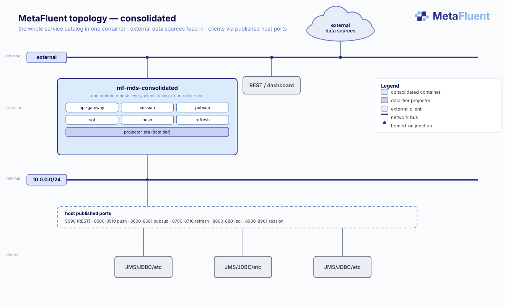
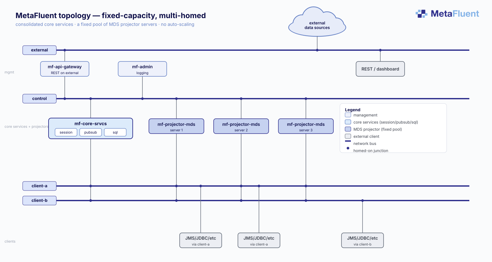
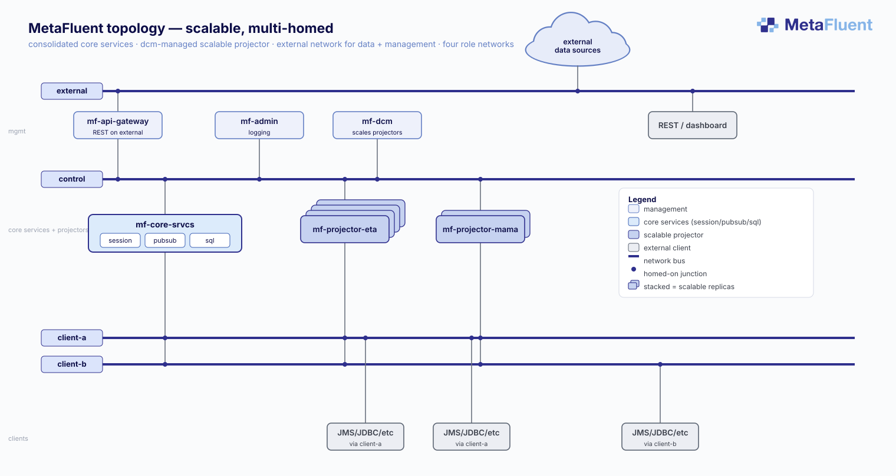
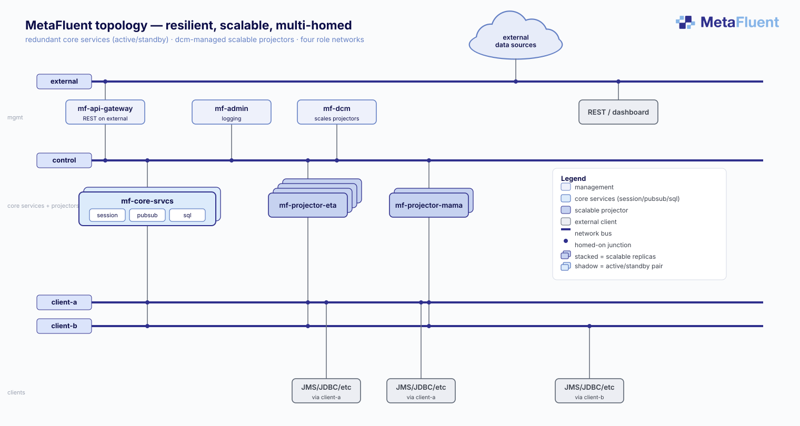
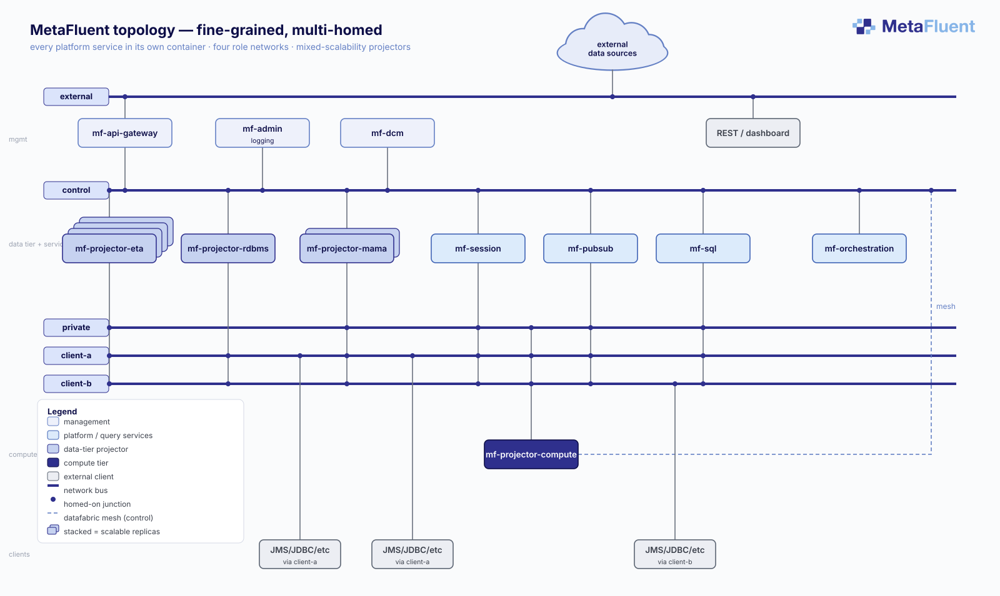
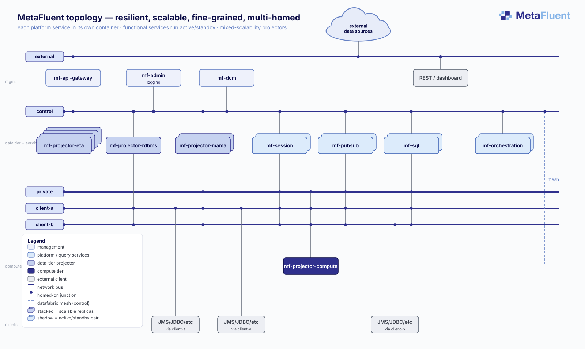

# Architecture: Advanced

Advanced topics for architects and operators, beyond the [Architecture: Basics](Architecture-Basics.md) mental model. It covers how the system stays available, how it is deployed, and how it handles load.

**Audience:** Architect, Operator.

---

## Resilience: three layers

Elastic MDS keeps a deployment available through three complementary mechanisms, coarsest to finest. They are independent, and a deployment combines the ones it needs:

- **Automatic restart.** The deployment substrate - Docker, Kubernetes, or a conventional service manager such as `systemd` - restarts a service that fails, and the other services tolerate a peer's brief absence and reconnect when it returns. Every deployment gets this baseline.
- **Active/standby.** The services that must not blink can run as hot standby pairs that take over in seconds (below).
- **Auto-scaling.** The projector tier grows and shrinks with load, so capacity tracks demand rather than being fixed at provisioning time (below).

A deployment might rely on restart alone, add active/standby for the services that carry client state, and add auto-scaling where load is elastic - each layer is opt-in.

---

## High availability: active/standby

The functional services that must behave as a single logical instance - the session, pub/sub, and SQL query servers, and the orchestration coordinator - can be run as **two or more physical instances** for availability. At any moment one instance is **ACTIVE** (serving clients) and the others are **STANDBY**.

**A standby is hot, not idle.** A standby instance maintains the same live view of the system as the active one, so its state stays current. It simply holds back from serving - it does not bind its servers or register its endpoints - until it is promoted.

**Failover is automatic and fast.** If the active instance stops or fails, a standby is promoted to ACTIVE and begins serving, with no operator intervention. Because the standby was already hot, takeover happens in a configurable interval **on the order of seconds** - not a cold restart.

**Projectors are different.** The projectors that ingest content all run **active together** - there is no idle standby. Where exactly one instance must own a piece of shared work, that coordination is handled internally, so nothing is duplicated and nothing is left unserved.

**Infrastructure components** - the API gateway and admin services - are *not* run active/standby. They rely on the deployment environment (Docker, Kubernetes, or `systemd` for a conventional install) to restart them if they fail, and the functional services tolerate their brief absence.

### How it manifests

Every instance reports its **role** over the gateway - `ACTIVE`, `STANDBY`, or `NEGOTIATING` while an election is in progress. The role is per-instance, so a redundant pair shows up as two instances of the same service, one `ACTIVE` and one `STANDBY`:

```
curl -s "http://mf-api-gateway:9090/api/application-state/v1/*/name,role,state"
```

`role` is distinct from `state`: `state` is the instance's operational health (is it working - the state model is in [Architecture: Basics](Architecture-Basics.md)), while `role` is its active/standby standing (is it the one serving). During a failover you would see a `STANDBY` instance become `ACTIVE`. Watching these is covered in [Operations: Monitoring & Diagnostics](Operations-Monitoring.md).

---

## Auto-scaling

Elastic MDS scales its compute tier by adding and removing whole **projectors** - the containers that host content adapters and serve query targets. Rather than resizing a running process, the platform grows capacity by launching more projectors and shrinks it by retiring ones no longer needed; a **container manager** handles starting and stopping them on the underlying infrastructure.

Scaling follows sustained load against each projector's capacity: when utilization stays above a high-water level, another projector is provisioned and new work is routed to it; when it stays comfortably below a low-water level, a projector is drained of its work and retired. The response is **damped** - brief spikes and dips do not trigger action, so capacity tracks the trend, not the noise.

Auto-scaling works **alongside redundancy, not instead of it**: a topology's configured minimum number of live copies is always maintained regardless of how many projectors are currently running, and scaling applies only to topologies designated **scalable** - fixed-size topologies are unaffected. When, and how aggressively, to scale is governed by a scaling **policy** a deployment can tune or replace.

The container manager has a different implementation per environment: a Docker-based one for **development and lab** use, and a Kubernetes-based one for **production**. Where neither container platform is in use, run at fixed capacity and rely on restart and active/standby for resilience. The scalable topologies this applies to are shown under [Deployment topologies](#deployment-topologies); running them is covered in [Deployment: Advanced](Deployment-Advanced.md).

---

## Deployment topologies

Elastic MDS runs the **same set of services** in every deployment. What changes is how those services are *packaged* into containers - from all-in-one to one-per-service - and how much redundancy and elasticity they carry. These are six representative topologies, ordered by increasing complexity; each is the identical service catalog arranged differently.

### Consolidated



- The entire client-facing and control surface collapses into a single image - gateway, session, pub/sub, SQL, push, refresh, and a data-tier projector, all co-resident.
- Clients reach it through published host ports. The simplest to stand up - ideal for development, labs, and small footprints.

### Fixed-capacity, multi-homed



- Structured like an existing JMS deployment: a set of interchangeable **servers** serving the same clients. Here core services (session / pub/sub / SQL) and a **fixed pool of MDS projectors** - three in the diagram - sit on the same plane across the role networks.
- Capacity is **set at deployment time**: you add or remove a projector by editing the deployment, not by policy. There is no container manager and no auto-scaling.
- The arrangement for a **known, steady workload** where fixed, predictable capacity is preferred over elasticity - and it maps directly onto a team's existing JMS-cluster mental model.

### Scalable, multi-homed



- Core services (session / pub/sub / SQL) sit together in one container; the **projectors** are a separate, scalable tier that the container manager (`mf-dcm`) fans out to replicas on demand.
- The arrangement for elastic content ingest - grow and shrink the data tier with load.

### Resilient, scalable, multi-homed



- The scalable topology made **highly available**: core services run as an active/standby pair - the shadow behind `mf-core-srvcs` - so a failure promotes the standby in seconds. The scalable projector tier is unchanged.
- The step you add when core services must not blink; the mechanism is [High availability: active/standby](#high-availability-activestandby) above.

### Scalable, fine-grained, multi-homed



- Every service runs separately - the most decomposed arrangement - across separate role networks (control, private, client).
- Maximum isolation, and it lets each service be scaled or made redundant independently. This is what a redundant production cluster looks like.

### Resilient, scalable, fine-grained, multi-homed



- The fully-decomposed topology with the functional services run **active/standby** - `mf-session`, `mf-pubsub`, `mf-sql`, and `mf-orchestration` each carry a hot standby, the shadow behind each. The projectors still run active together, and the gateway and admin services rely on restart.
- The most available arrangement: each service that carries client state has a standby ready to take over.

### From a monitoring perspective, they look the same

This is the point that matters for running the system: **operationally, the topologies are interchangeable.** They expose the identical service catalog behind the identical gateway API surface, so every query on the [Operations: Monitoring & Diagnostics](Operations-Monitoring.md), [Operations: Logging](Operations-Logging.md), and [REST API](REST-API.md) pages runs unchanged against any of them. Topology is a deployment decision, not an operational one.

Only three things actually differ when you operate one versus another:

- **How many instances you watch** - a few (aggregated) versus many (fine-grained).
- **Whether services are redundant.** A redundant deployment runs active/standby pairs; those show up as two same-named instances, one `ACTIVE` and one `STANDBY`. **Not every deployment is redundant** - many run a single instance of each service.
- **Whether the projector tier scales** - a scalable topology adds and removes projector replicas through `mf-dcm`.

Choosing a topology is covered in [Deployment: Basics](Deployment-Basics.md); how to network and deploy each topology - flat vs segmented, bind vs advertise, and the substrate-by-substrate recipes - is in [Deployment: Advanced](Deployment-Advanced.md).

---

## Slow-consumer protection: delivery scaling and conflation

A single distribution server fans the same updates out to many independent consumer connections. If one consumer - its application, its network, or a downstream system - cannot keep pace with the update rate it subscribed to, unread data backs up on the server for that connection. Left unmanaged, that backlog consumes shared resources and can degrade delivery for **other** consumers on the same server, including ones handling the very same data comfortably. Ultimately, a slow consumer risks being disconnected.

Elastic MDS protects against this automatically, through two complementary mechanisms: it **scales delivery** for a consumer that is starting to fall behind and, where configured, **conflates** that consumer's streams. Both mechanisms engage and disengage automatically based on configured policies, with no application code change.

### Automatic delivery scaling

Delivery scaling starts the moment an application connects. When a query first runs, every stream in its result is delivered an initial image before live updates begin. Together those images are a burst far heavier than the steady update flow that follows - heavy on both I/O and the CPU that builds and encodes them - and they arrive while the runtime is still warming up. The set of streams in a result is delivered over one or more shards, each a separate connection carrying the streams for a share of the result's rows; to absorb that opening burst, Elastic MDS starts the result on more shards than steady state needs, spreading the load across them so it lands quickly. As the initial images finish and the runtime warms up - both easing the load - the result consolidates onto fewer shards for the ongoing updates.

Delivery scaling then keeps applying as update load rises and falls through the day. Orchestration continuously watches how well each consumer connection is keeping up. A new or recently active connection is treated cautiously - assumed potentially slow until it proves sustained fast performance - because it is safer to be briefly careful with a fast consumer than to miss a slow one. As a connection approaches its policy-defined capacity ceiling, orchestration spreads the result across an additional shard, so each connection carries fewer streams and none is asked to carry more than it can absorb. When the rate eases and the connection is comfortably keeping up again, the result consolidates back onto fewer shards.

Spreading and consolidating a result are both carried out by moving individual streams between shards, and orchestration uses the same mechanism to rebalance load across the shards already in use when it drifts unevenly. This movement is seamless and completely transparent to the application: a stream changes shards with no data lost and no stale value along the way, and the consumer simply keeps receiving current updates throughout.

Delivery scaling is **on by default** - a deployment gets it simply by running, with no per-consumer configuration. A consumer that has been running slow is given the extra capacity earlier than one that has been running fast, so the protection engages ahead of a backlog rather than after one has already formed.

### Conflation

If a connection still cannot sustain the offered rate even once delivery has scaled - or an operator would rather bound the volume delivered to a consumer than add connections for it - Elastic MDS **conflates** that consumer's streams. Multiple pending updates to the same row collapse into the latest value, so the consumer always receives current data and never builds a backlog, at the cost of not seeing every intermediate change along the way. Conflation is applied through **conflation rules** that an operator configures for particular users, applications, or queries. When a consumer connects, the matching rule is assigned to its session; a consumer that no rule matches is not conflated. Conflation then engages and disengages automatically as the connection's load crosses the rule's thresholds. Configuring rules is covered in [Configuration Cookbook: Slow Consumer Protection](Cookbook-Configure-Slow-Consumer-Protection.md).

### How they work together

Delivery scaling adds capacity so a consumer can keep up with its updates; conflation reduces the number of updates it has to handle. Every consumer gets delivery scaling by default. A consumer that needs more than that - because no amount of added capacity will let it keep up, or because an operator prefers to bound its volume outright - also gets conflation where the operator has configured a rule that matches it. The two stack independently: a consumer can be protected by delivery scaling alone (the default), by conflation alone, or by both together.

The result: one deployment serves demanding low-latency consumers and slower ones side by side, protects the fast consumers from a neighbor's problem, and stays stable through load bursts such as a market open. How many shards are currently serving a consumer's result, and whether conflation is engaged, are both visible in [resource monitoring](Operations-Monitoring.md#resource-monitoring).

---

## Isolating access by deployment topology

Orchestration in Elastic MDS is **network-aware**. Every content request carries the network identity of the client that made it, and orchestration only assigns that request to a tier the client can actually reach. It never routes content to a resource on a network the client has no path to - instead it delivers everything the client needs, whether sourced directly or derived through computation, out through whatever tier *is* reachable to them.

That single behavior turns ordinary network segmentation - which large enterprises do anyway - into a tool for both **isolation** and **cost attribution**.

There is one active orchestration coordinator for the whole cluster: a single point of *control*, not a single point of failure - it can run a hot standby that takes over exactly like the other functional services above. It sees the entire deployment, but it applies a **separate policy to each tier**, and it delivers to each tier only where clients can reach it.

### A business unit's own isolated slice

Give a business unit its own client network and its own projector tier, and home the data tier, the control network, and other business units' networks **off** that network. Because orchestration delivers content only where the client can reach it, the business unit still receives everything it subscribes to - raw and derived alike - routed out to its own projector tier. That tier is the only bridge onto the business unit's network, and it is a one-way *delivery* path, not a way in.

The security payoff is **containment by construction**. A bad actor who compromises an application or a host on the business unit's network is confined to it: the data tier, the control plane, and every other business unit sit on networks that segment has no route to - there is nothing to pivot to. You get full function on the business unit's network without ever exposing the sensitive tiers, or the other business units, to it.

### A cost boundary too

The projector tier is also the **compute node** for that business unit, which makes it the natural place to account for cost. Because the coordinator applies a distinct policy per tier, a business unit's projector tier can be made [scalable](#auto-scaling) and grow or shrink under a policy of its own - how many projectors, and how aggressively they scale. The business unit sets its own capacity envelope and owns the spend, independent of the data tier and of every other business unit's tier.

*(The projector tier is a compute node you can shape further - with derived content, and in time libraries of your own. Those capabilities deepen this model and are documented as they land.)*

How you actually draw these boundaries - segmented networks and per-network reachability - is covered in [Deployment: Advanced](Deployment-Advanced.md).

---

## Where to go next

- [Architecture: Basics](Architecture-Basics.md) - the core model this builds on.
- [Operations: Monitoring & Diagnostics](Operations-Monitoring.md) - seeing role and state on a running system.
- [Deployment: Advanced](Deployment-Advanced.md) - running the redundant instances that make active/standby possible.
- [Glossary](Glossary.md) - definitions of the terms used here.
