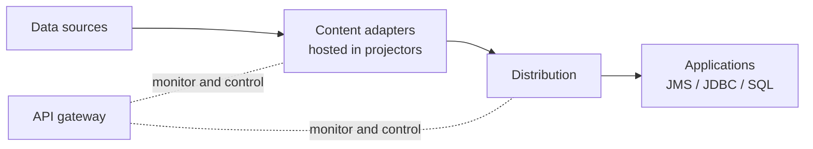
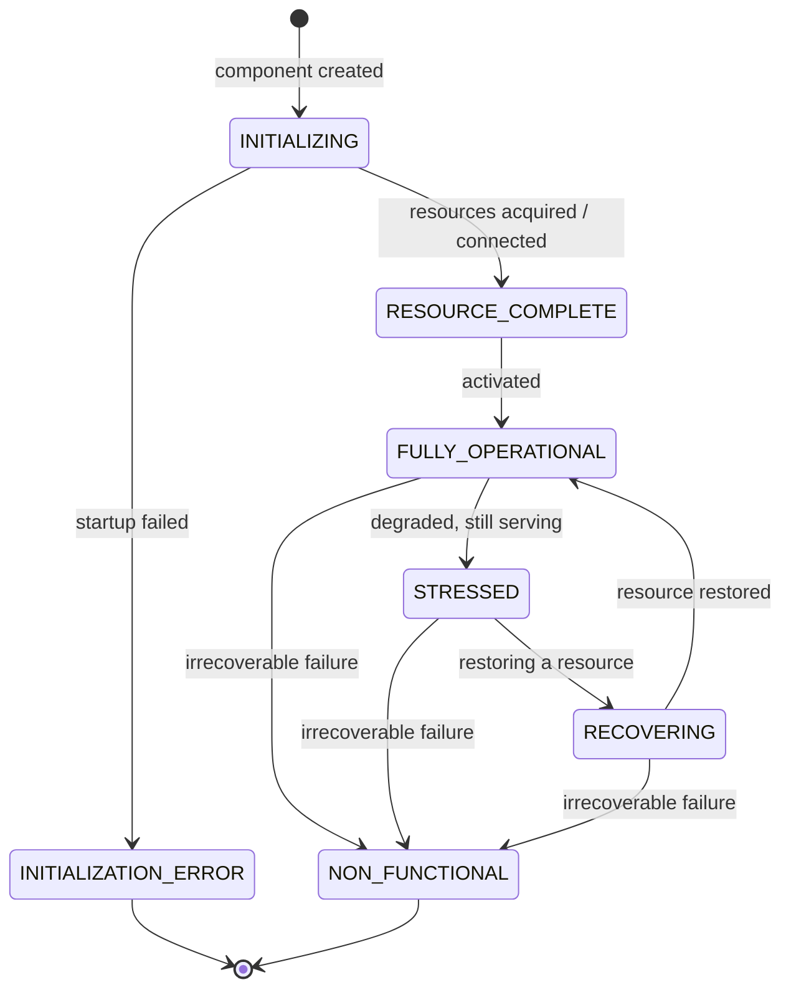

# Architecture: Basics

Elastic MDS gives applications unified, standards-based access to high volumes of real-time and non-real-time data drawn from many sources. This page describes the components the system is built from and how a request flows through them, at a conceptual level. The mechanisms behind distribution, elasticity, and resilience are covered in [Architecture: Advanced](Architecture-Advanced.md).

Elastic MDS is built on the **StreamLens** integration framework.

**Audience:** architects and evaluators assessing fit; developers who want the model behind the APIs.

---

## The problem it addresses

An enterprise holds data across many systems - market-data feeds, databases, files, message buses - each with its own access method, format, and update behaviour. An application that needs to combine that data, and to act on it as it changes, otherwise has to integrate each source directly.

Elastic MDS presents all of that content through a small set of standard interfaces - **JMS, JDBC, and SQL** - regardless of where the content originates or whether it is real-time or static. An application works against one consistent representation of content, using interfaces it already knows.

---

## The components

Reading from the data outward:

- **Content adapters** connect to a data source, bring its content into the platform, and keep it current with the source.
- **Projectors** are the deployable units that host one or more content adapters. A deployment runs one or more projectors, each responsible for some set of content.
- **Distribution** delivers content to applications over the wire, using the protocol appropriate to each application.
- **Applications** connect through industry-standard APIs (JMS, JDBC, and their non-Java equivalents) and rely on industry standards such as SQL. Monitoring applications use industry-standard REST.
- The **API gateway** provides a single REST surface for monitoring and controlling every component across the deployment - the surface used in the [Quick Start](Quick-Start.md) to confirm health.

---

## Core concepts

- **Content** - the data itself, whether real-time (continuously updating) or static. Content is represented as tables of fields; each unit of content is identified so that an application can request it and the platform can locate and deliver it.
- **Content adapter** - the component that understands a particular kind of source (a market-data feed, a relational database, a set of files) and represents that source's data as platform content. Each source type has its own adapter; the rest of the system works against content uniformly, without regard to the source.
- **Query** - how an application states what content it wants. Applications use familiar mechanisms - an SQL statement, a topic subscription - and do not need to know which adapter or host holds the data.
- **Distribution** - how content reaches an application once it has been requested. Elastic MDS supports delivery by push (each change is sent as it happens) and by refresh (the application reads current values when it needs them). The distinctions are covered in [Architecture: Advanced](Architecture-Advanced.md).
- **Session** - an application's authenticated connection and the context under which it accesses content.
- **API gateway** - the deployment's REST control surface, aggregating every component so that a single request can read state or statistics from across the system.

---

## How a request is handled

When an application requests content, the same path is followed each time:

1. The application opens a **session** through a standard interface.
2. It issues **one or more queries** for the content it wants.
3. The platform interprets the request and, because ingestion is **interest-driven**, ensures the relevant content is being brought in by the appropriate adapter.
4. The application begins receiving the requested content and is kept current with it as the source changes. How updates reach the application - streamed as they happen, or read on demand - depends on the distribution model (see [Architecture: Advanced](Architecture-Advanced.md)).
5. When no application is interested in a unit of content, the platform can release the resources holding it.

The [Quick Start](Quick-Start.md) exercised this path: the sample subscriber opened a session, asked for one instrument, and (over push) received an initial image followed by updates.

---

## Component state

Every component - and each constituent inside it - reports an operational **state** that says where it is in its lifecycle: starting up, healthy, degraded, or failed. A container's state is the **worst** of its constituents' states, so a container is `FULLY_OPERATIONAL` only when all of its parts are.

A component moves through two phases:

- **Startup** - `INITIALIZING` (acquiring resources and connections) to `RESOURCE_COMPLETE` (ready) to `FULLY_OPERATIONAL`. A startup that cannot complete ends in `INITIALIZATION_ERROR`.
- **Runtime** - from `FULLY_OPERATIONAL`, a component may become `STRESSED` (degraded but still serving) or `RECOVERING` (restoring a resource it lost), returning to `FULLY_OPERATIONAL` once it clears. An unrecoverable runtime failure ends in `NON_FUNCTIONAL`.

You read these states on a running system over the gateway - see [Operations: Monitoring & Diagnostics](Operations-Monitoring.md). How redundant instances layer an active/standby **role** on top of this state is covered in [Architecture: Advanced](Architecture-Advanced.md).

---

## Standard interfaces, existing skills

Content is accessed through the industry standards - **JMS, JDBC, and SQL** (the query language is a subset of **SQL-92**). The deployment is monitored and controlled over a standard **REST** API. A developer who knows those already knows how to work against Elastic MDS.

Applications written for MetaFluent v5 are fully compatible and run unchanged - they continue to use the existing `com.metafluent.jms_context.mds` context exactly as before. The new **MarketData** context unlocks additional features. See [JMS Application Development](Develop-JMS.md).

---

## Where to go next

- [Architecture: Advanced](Architecture-Advanced.md) - distribution models, state sharing, elasticity, and resilience.
- [Glossary](Glossary.md) - definitions of the terms used here.
- [JMS Application Development](Develop-JMS.md) - build an application against the model described above.
